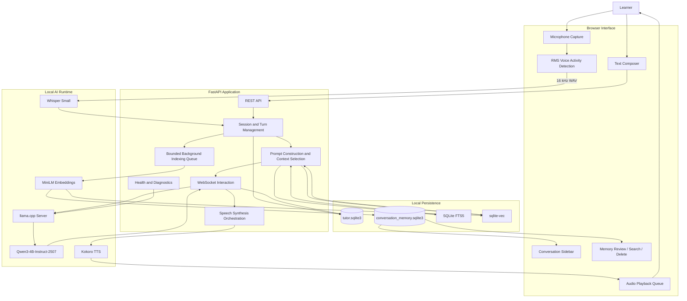
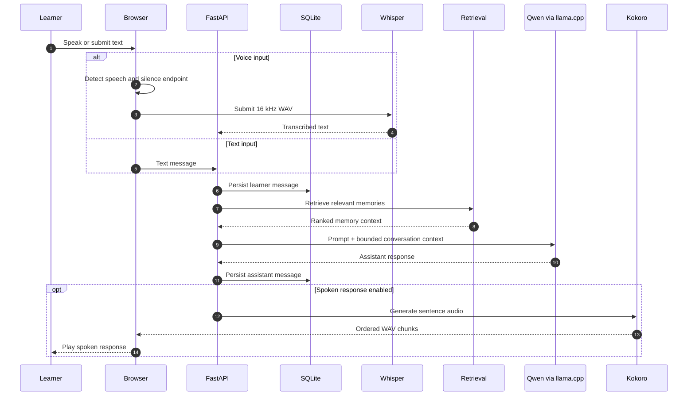
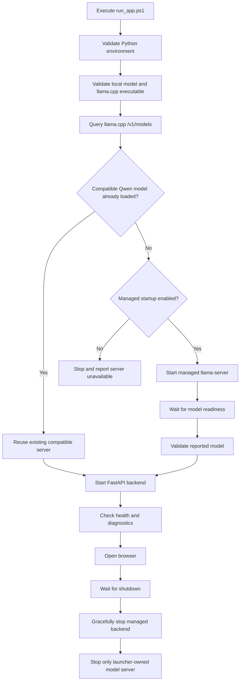

# English Speaking Tutor

### A Local-First AI Tutor for Spoken English Practice, Voice Conversations, and Persistent Conversational Memory

English Speaking Tutor is a locally hosted AI application designed to help learners practice English through natural text and voice conversations.

It combines a locally served language model, automatic speech recognition, neural text-to-speech, persistent conversation history, and hybrid memory retrieval into a single browser-based experience.

Unlike a conventional chatbot that only accepts text and returns text, this application supports a hands-free speaking workflow: the learner speaks into a microphone, the application detects the end of the utterance, transcribes the audio locally, sends the text to a local language model, persists the resulting conversation, and generates spoken replies.

The application is designed around **local execution and data ownership**. Language inference, speech recognition, speech synthesis, and conversation retrieval run locally rather than depending on hosted AI APIs.

The current implementation uses:

- **Qwen3-4B-Instruct-2507** for conversational generation through llama.cpp.
- **Whisper Small** for speech recognition.
- **Kokoro TTS** for spoken responses.
- **MiniLM** for neural sentence embeddings.
- **SQLite FTS5 + sqlite-vec** for hybrid conversation-memory retrieval.
- **FastAPI** for the application backend.
- **JavaScript** for the browser interface and voice interaction layer.

---

## Table of Contents

- [Why This Project](#why-this-project)
- [Key Capabilities](#key-capabilities)
- [System Architecture](#system-architecture)
- [End-to-End Conversation Workflow](#end-to-end-conversation-workflow)
- [Voice Interaction Pipeline](#voice-interaction-pipeline)
- [Local LLM Inference](#local-llm-inference)
- [Persistent Conversations and Memory](#persistent-conversations-and-memory)
- [Hybrid Memory Retrieval](#hybrid-memory-retrieval)
- [Text-to-Speech and Audio Playback](#text-to-speech-and-audio-playback)
- [Backend Components](#backend-components)
- [Frontend Components](#frontend-components)
- [Application Startup and Process Management](#application-startup-and-process-management)
- [Technology Stack](#technology-stack)
- [Repository Structure](#repository-structure)
- [Requirements](#requirements)
- [Installation and Setup](#installation-and-setup)
- [Configuration](#configuration)
- [Voice Controls](#voice-controls)
- [Data Storage and Privacy](#data-storage-and-privacy)
- [Testing and Evaluation](#testing-and-evaluation)
- [Measured Results](#measured-results)
- [Current Implementation Status](#current-implementation-status)
- [Engineering Decisions](#engineering-decisions)
- [Known Limitations](#known-limitations)
- [Future Development](#future-development)

---

## Why This Project

Learning spoken English requires more than memorizing vocabulary or reading grammar explanations. Learners need repeated opportunities to speak, formulate sentences, listen to responses, and continue conversations without feeling constrained by a classroom environment.

Traditional learning applications often focus on static lessons, predefined exercises, or text-based interactions. A conversational AI tutor offers a different approach: learners can practice expressing thoughts in their own words and receive contextual responses.

However, voice-enabled AI applications introduce several engineering challenges:

- How can speech be captured without requiring the learner to manually record every sentence?
- How can the application identify when the learner has finished speaking?
- How can speech recognition, language generation, and speech synthesis work together without sending private audio to external services?
- How can the tutor retain useful conversational context across multiple sessions?
- How can semantic retrieval work efficiently on a resource-constrained laptop?
- How can microphone capture and audio playback coexist without making interruptions difficult?

English Speaking Tutor explores these problems through a local-first architecture combining several independent AI components.

**The goal is to make spoken English practice accessible through a persistent, locally running conversational assistant.**

---

## Key Capabilities

| Capability | Implementation |
|---|---|
| Text conversations | Browser-based conversational interface |
| Voice conversations | Hands-free microphone interaction |
| Speech detection | Browser-side RMS-based voice activity detection |
| Speech transcription | Local Whisper Small inference |
| Conversational generation | Local Qwen3 model through llama.cpp |
| Spoken responses | Kokoro TTS |
| Sentence-level audio output | Ordered WAV chunks with browser playback queue |
| Conversation persistence | SQLite session and message storage |
| Multiple conversations | Independent persistent chat sessions |
| Conversation memory | Persistent episode-memory index |
| Semantic retrieval | MiniLM embeddings |
| Lexical retrieval | SQLite FTS5 |
| Vector similarity | sqlite-vec |
| Retrieval ranking | Reciprocal Rank Fusion |
| Memory management | Review, search, and delete interface |
| Diagnostics | Local health and diagnostics endpoints |
| Model lifecycle | Managed llama.cpp startup and readiness checks |

---

## System Architecture

The application follows a **local-first, component-oriented architecture**.

It separates browser interaction, application orchestration, conversational inference, speech processing, persistence, and memory retrieval.

The browser does not directly load the language model. It communicates with the FastAPI application, which coordinates the local inference server and the supporting AI components.

### High-level architecture



### Architectural responsibilities

| Component | Responsibility |
|---|---|
| Browser | Text input, microphone controls, conversation display, audio playback |
| FastAPI | API endpoints, session orchestration, request lifecycle |
| llama.cpp | Local model serving through an OpenAI-compatible API |
| Qwen3 | Conversational response generation |
| Whisper | Audio-to-text transcription |
| Kokoro | Text-to-audio synthesis |
| SQLite session store | Persistent chats and messages |
| Memory subsystem | Episode indexing and retrieval |
| MiniLM | Semantic sentence embeddings |
| FTS5 | Lexical retrieval |
| sqlite-vec | Vector similarity search |
| PowerShell launcher | Local process startup, model readiness, cleanup |

---

## End-to-End Conversation Workflow

The central application workflow connects text or voice input to a persistent conversational turn.

### Text conversation

1. The learner opens the browser application.
2. A conversation is selected or a new conversation is created.
3. The learner submits a text message.
4. The backend persists the learner message before model inference.
5. The application constructs a bounded prompt using conversation history and relevant retrieved memories.
6. The request is sent to the local llama.cpp server.
7. Qwen3 generates the assistant response.
8. The assistant response is persisted.
9. The browser displays the new response.

Persisting the learner's message before inference is important: a local model-server failure should not silently discard what the learner submitted.

### Voice conversation

1. The learner activates the microphone.
2. The browser captures audio and monitors microphone energy.
3. Speech detection identifies a speaking segment.
4. The application waits for the configured silence endpoint.
5. The captured audio is converted to 16 kHz WAV.
6. Whisper Small transcribes the utterance locally.
7. The transcript enters the same conversational pipeline used by text input.
8. Qwen3 generates the response.
9. The assistant response is persisted.
10. Kokoro synthesizes the response into sentence-sized audio chunks.
11. The browser plays the chunks in order.
12. The microphone remains active for the next turn.

### Workflow diagram



---

## Voice Interaction Pipeline

The voice interface is one of the core engineering components of this project.

Rather than asking the learner to press a record button for every utterance, the browser uses an energy-based speech detection mechanism to identify speaking segments and automatically finalize turns.

### 1. Microphone capture

The browser requests microphone access and captures audio through the browser audio APIs.

The application requests echo cancellation, although this does not guarantee complete isolation between speaker output and microphone input.

### 2. Noise calibration

At startup, the browser measures the ambient noise floor.

The current implementation uses a 750 ms initial calibration interval and maintains a configurable noise margin.

The default adaptive margin is 0.03, with a minimum RMS threshold of 0.045 under the current version's detector settings.

This helps distinguish normal background noise from a sustained speaking signal.

### 3. RMS-based speech detection

The browser calculates Root Mean Square (RMS) audio energy over incoming audio frames.

RMS provides a measure of signal amplitude:

\[
RMS = \sqrt{\frac{1}{N}\sum_{i=1}^{N}x_i^2}
\]

The detector uses:

- A calibrated ambient noise floor.
- A configurable speech threshold.
- A short sustained-onset check.
- Pre-roll buffering.
- Continuous-silence endpoint detection.

The current detector uses:

| Parameter | Current behavior |
|---|---|
| Noise calibration | 750 ms |
| Steady-state pre-roll | 250 ms |
| Sustained onset check | 250 ms |
| Default silence endpoint | 3 seconds |
| Maximum segment duration | 90 seconds |

These parameters are configurable or represented in the voice settings where applicable.

### 4. Audio finalization

When the silence endpoint is reached, the browser finalizes the buffered utterance and submits it for transcription.

Manual microphone stop also finalizes and submits the captured utterance instead of simply discarding it.

Empty and very short segments are ignored.

The maximum segment duration prevents an uninterrupted capture from growing indefinitely; longer speech is split into a subsequent segment.

### 5. Local speech recognition

The audio is submitted as a 16 kHz WAV file to the local Whisper Small model, which returns the recognized text.

The transcript is then handled as a learner message.

### 6. Interruption and playback

The microphone remains active between turns.

When new speech is detected during playback, the browser attempts to stop current playback promptly and prioritize the new utterance.

The application also supports stopping playback or cancelling a WebSocket response through the Escape key.

**Current limitation:** a physical spoken barge-in and repeated real-device interruption behavior have not been fully verified. The project has deterministic tests for the browser voice lifecycle, but those tests do not prove microphone behavior on every browser and audio device.

---

## Local LLM Inference

The conversational engine uses Qwen3-4B-Instruct-2507 through a local llama.cpp server.

The language model is served separately from FastAPI using llama.cpp's OpenAI-compatible HTTP interface.

### Why llama.cpp?

The local inference server provides:

- Local model execution.
- A standardized chat-completions interface.
- Control over the GGUF model file.
- Configurable context size.
- Configurable GPU-layer offloading.
- Independent model-server lifecycle management.

The configured default model is:

```text
models/llm/Qwen3-4B-Instruct-2507-Q4_K_M.gguf
```

The default server endpoint is:

```text
http://127.0.0.1:8080
```

The application checks the loaded model through:

```text
GET /v1/models
```

The expected model identifier is checked before reusing an already running server.

If the correct model is not available and managed startup is enabled, the launcher starts the configured llama.cpp executable.

### Prompt construction

The backend manages conversational context rather than sending an unlimited transcript to the model.

It combines:

- The current learner message.
- Recent conversation history.
- Relevant retrieved memory context.
- A bounded prompt budget.

This is important on resource-constrained local models, where excessive history can consume context-window capacity and increase inference work.

### Model boundary

The application does not implement its own transformer inference engine.

Qwen generation is delegated to llama.cpp. FastAPI acts as the orchestration layer and communicates with the existing local model server.

---

## Persistent Conversations and Memory

The application maintains two separate SQLite databases for different responsibilities.

<details>
<summary><strong>1. Conversation/session storage</strong></summary>

Database:

```text
data/tutor.sqlite3
```

This database stores persistent sessions and complete user/assistant messages.

Its responsibilities include:

- Conversation persistence.
- Session restoration.
- Message history.
- Multiple independent conversations.
- Chat deletion.

A new browser tab starts a fresh conversation, while refreshing an existing tab restores its current conversation. Previous conversations remain available through the sidebar.

</details>

<details>
<summary><strong>2. Conversation-memory storage</strong></summary>

Database:

```text
data/conversation_memory.sqlite3
```

This database stores the separate conversation-memory index used for retrieval.

It supports:

- Episode-memory indexing.
- Textual/lexical search.
- Neural vector search.
- Memory review.
- Memory deletion.
- Associations between newly created memories and their source conversations.

The memory system is separate from the full transcript store so that retrieving relevant historical context does not require loading every conversation message.

</details>

### Why separate the databases?

Conversation history and retrieval indexes have different responsibilities.

The session database is the durable record of what the learner and assistant said.

The memory database is an optimized retrieval structure designed to surface potentially useful context.

This separation also allows the retrieval index to be rebuilt or re-embedded without treating the index itself as the authoritative conversation history.

### Memory lifecycle

The implemented memory workflow includes a bounded background queue that indexes completed conversation episodes.

The current implementation does not yet perform full learner-fact extraction, memory consolidation, or automated vocabulary scheduling.

---

## Hybrid Memory Retrieval

A particularly interesting engineering component is the local hybrid retrieval system.

The application combines lexical and neural retrieval instead of relying exclusively on keyword matching or vector similarity.

### Retrieval components

| Component | Purpose |
|---|---|
| SQLite FTS5 | Full-text lexical retrieval |
| MiniLM | Sentence-level semantic embeddings |
| sqlite-vec | Vector similarity search |
| Reciprocal Rank Fusion | Combines independent ranking signals |
| SQLite | Persistent local retrieval records |

### 1. Neural embeddings

The application uses:

```text
sentence-transformers/all-MiniLM-L6-v2
```

The model converts text into numerical embeddings that represent semantic relationships.

This helps identify related conversation content even when the learner uses different words from the original discussion.

For example, a new query about "difficulty speaking in interviews" may be related to a previous conversation about "getting nervous during job discussions."

Keyword-only search may not recognize that relationship as effectively.

### 2. Vector similarity

The generated embeddings are stored and queried using sqlite-vec.

This enables semantic similarity retrieval without requiring a separately hosted vector database.

### 3. Lexical retrieval

SQLite FTS5 provides a complementary search mechanism based on terms and textual matching.

This is useful when the learner refers to a specific named topic, technical term, or phrase.

### 4. Reciprocal Rank Fusion

The retrieval system combines the ranked candidate lists using Reciprocal Rank Fusion (RRF).

A simplified form of RRF is:

\[
RRF(d)=\sum_{r \in R}\frac{1}{k+rank_r(d)}
\]

Where:

- \(d\) is a candidate memory.
- \(R\) is the set of retrieval result lists.
- \(rank_r(d)\) is the rank of that memory in a particular list.
- \(k\) is a smoothing constant.

Combining ranked lists helps balance exact textual relevance with semantic relevance.

### 5. Embedding migration and fallback

The implementation supports versioned embedding records and re-embedding of older feature-hash memories when the local neural model cache is available.

If the neural weights or vector extension are unavailable, the application reports a feature-hash/FTS fallback mode.

Neural model weights are cached locally and are not committed to the Git repository.

### Retrieval evaluation

The repository includes a small labelled retrieval fixture and an evaluation script:

```powershell
.\.venv\Scripts\python.exe scripts\evaluate_retrieval.py
```

The recorded smoke evaluation returned 5/5 labelled paraphrase queries in the top three results.

This is a small functional evaluation, not a general-purpose retrieval benchmark.

---

## Text-to-Speech and Audio Playback

Spoken assistant responses are generated using Kokoro TTS.

The current voice configuration uses:

```text
af_heart
```

### Speech synthesis workflow

1. The LLM response is generated.
2. Text is cleaned for speech output.
3. Markdown artifacts are removed or normalized.
4. Common abbreviations are expanded where configured.
5. The text is divided into sentence-sized units.
6. Kokoro generates WAV audio for each sentence.
7. The backend streams ordered audio chunks to the browser.
8. The browser queues and plays the chunks in sequence.

### Sentence-level audio streaming

The application supports sentence-level TTS streaming.

This means the browser can begin receiving and playing completed speech chunks while later sentences are still being synthesized.

The playback queue is bounded to avoid uncontrolled audio accumulation.

New detected speech and Escape can stop or clear playback.

### Important streaming distinction

The application streams **TTS audio chunks**, not LLM tokens.

The full LLM response is generated before speech synthesis begins.

There is currently no token-by-token LLM streaming or cancellation of an in-flight llama.cpp generation request.

---

## Backend Components

The backend lives in `app/` and is implemented in Python.

### `app/main.py` — Application orchestration

The main FastAPI application is responsible for:

- Application lifecycle.
- REST API routes.
- WebSocket communication.
- Session and conversation operations.
- Message handling.
- Diagnostics.
- Memory review and deletion interfaces.
- Coordinating local inference and response generation.

It is the main integration point connecting the frontend, persistence, LLM server, and speech pipeline.

### `app/llm.py` — Language model integration

Provides the interface to the local OpenAI-compatible llama.cpp server.

Its responsibility is to isolate the conversational application from the underlying model-serving process.

This keeps LLM transport and response generation concerns separate from the rest of the application.

### `app/store.py` — Persistent session storage

Provides the SQLite-backed persistence layer for conversation sessions and messages.

This component allows the frontend to restore past conversations and maintain a durable record of learner and assistant turns.

### `app/memory.py` — Memory lifecycle and indexing

Implements the application's conversation-memory operations and coordinates memory-related persistence.

It is responsible for the separate memory store and operations exposed through the application.

### `app/retrieval/` — Hybrid retrieval subsystem

Contains the retrieval implementation, including neural embeddings and local vector/lexical search integration.

Its purpose is to find relevant historical conversation material that can be included in the prompt context.

### `scripts/` — Runtime and engineering utilities

Contains:

- Terminal-based voice tutor prototype.
- Backend runner.
- Voice pipeline checks.
- Frontend voice lifecycle regression checks.
- Retrieval evaluation.
- TTS utilities and smoke checks.

These scripts provide a practical way to test individual parts of the system independently from the browser interface.

---

## Frontend Components

The frontend is implemented in JavaScript and serves the browser-based tutor interface.

### `frontend/app.js`

The primary frontend application logic handles:

- Conversation interactions.
- Browser microphone capture.
- Voice activity detection.
- Audio capture and submission.
- WebSocket interaction.
- Voice settings.
- Playback queue management.
- Conversation history.
- Memory review and search.
- UI state and user feedback.

### Browser UI responsibilities

The interface provides:

- Text conversation input.
- Hands-free microphone interaction.
- Microphone-level and speech-detection status.
- Silence countdown and capture feedback.
- Spoken response playback.
- Conversation sidebar.
- Previous conversation restoration.
- Memory review/search/delete panel.
- Voice settings and device preferences.
- Local model diagnostics.

### Browser-persisted settings

Voice settings are saved in the browser and can include:

- Input device selection.
- Output device selection where supported.
- Spoken-response preference.
- Noise sensitivity.
- End-of-turn silence delay.

The actual availability of device-selection behavior depends on browser support.

---

## Application Startup and Process Management

The project includes a dedicated Windows PowerShell launcher:

```text
run_app.ps1
```

This script coordinates the startup of the local model server and FastAPI backend.

The intent is to avoid requiring the user to manually start multiple processes in the correct order.

### Startup workflow



### Process ownership

The launcher distinguishes between an already-running compatible external llama.cpp server and a process it started itself.

It does not stop an external server during shutdown.

For the application backend, the launcher uses a shutdown token and a graceful shutdown endpoint before falling back to terminating only the process it owns.

This is important because blindly terminating processes by port or executable name could interfere with unrelated local applications.

### Default local endpoints

| Component | Address |
|---|---|
| FastAPI app | `http://127.0.0.1:8765` |
| llama.cpp server | `http://127.0.0.1:8080` |
| Health endpoint | `/api/v1/health` |
| Diagnostics endpoint | `/api/v1/diagnostics` |
| LLM model listing | `/v1/models` |

The launcher binds the application and managed inference server to loopback addresses.

---

## Technology Stack

| Layer | Technology | Purpose |
|---|---|---|
| Language | Python 3.12 | Backend and orchestration |
| API framework | FastAPI | REST and WebSocket endpoints |
| ASGI server | Uvicorn | Serving the backend |
| LLM serving | llama.cpp | Local GGUF inference |
| LLM | Qwen3-4B-Instruct-2507 | Conversational generation |
| Speech recognition | OpenAI Whisper Small | Speech-to-text |
| Text-to-speech | Kokoro | Spoken response generation |
| Embeddings | Sentence Transformers | Semantic memory representation |
| Embedding model | all-MiniLM-L6-v2 | Compact local sentence embeddings |
| Vector retrieval | sqlite-vec | Local vector similarity |
| Full-text retrieval | SQLite FTS5 | Lexical search |
| Persistence | SQLite | Sessions and memory |
| Audio input | Browser audio APIs, sounddevice | Microphone capture |
| Audio processing | NumPy, SoundFile | Audio processing and WAV handling |
| Frontend | JavaScript | Browser application |
| Runtime management | PowerShell | Windows process startup and cleanup |
| Testing | pytest, Node.js scripts | Backend and frontend lifecycle checks |

---

## Repository Structure

```text
EnglishSpeakingTutor/
│
├── app/
│   ├── main.py                 # FastAPI application and orchestration
│   ├── llm.py                  # Local llama.cpp integration
│   ├── memory.py               # Memory operations and indexing
│   ├── store.py                # SQLite conversation persistence
│   │
│   └── retrieval/
│       └── embeddings.py       # Neural embedding and retrieval logic
│
├── frontend/
│   ├── app.js                  # Browser application and voice pipeline
│   ├── fonts.css
│   └── favicon.svg
│
├── models/
│   ├── llm/                    # Local Qwen GGUF model
│   ├── embeddings/             # Local embedding model cache
│   └── ...
│
├── runtime/
│   └── llama.cpp/              # Local llama.cpp runtime
│
├── data/
│   ├── tutor.sqlite3           # Conversation sessions and messages
│   └── conversation_memory.sqlite3
│
├── logs/                       # Runtime logs
│
├── docs/
│   └── architecture-status.md  # Implementation evidence and open work
│
├── scripts/
│   ├── voice_tutor.py
│   ├── run_backend.py
│   ├── evaluate_retrieval.py
│   ├── test_frontend_voice.js
│   ├── test_voice_pipeline.py
│   └── ...
│
├── tests/
│   ├── test_api.py
│   ├── test_memory.py
│   ├── test_retrieval.py
│   └── test_store.py
│
├── pyproject.toml
├── run_app.ps1
├── run_tutor.ps1
└── README.md
```

Model binaries, caches, and runtime artifacts are local assets and may not be present in a fresh clone. Consult `.gitignore`, the launcher, and the project setup instructions before assuming those assets are included.

---

## Requirements

The current application is designed for local execution on Windows.

### Software

- Windows.
- Python 3.12.
- A Python virtual environment at `.venv`.
- Node.js for the JavaScript regression script.
- The bundled or configured llama.cpp server executable.
- A compatible local Qwen GGUF model.
- Microphone and speaker/headphone hardware for voice interaction.

### Model assets

The default language-model file is:

```text
models/llm/Qwen3-4B-Instruct-2507-Q4_K_M.gguf
```

Whisper Small and Kokoro load their model weights locally on first use.

The neural retrieval model is:

```text
sentence-transformers/all-MiniLM-L6-v2
```

The model cache is stored under:

```text
models/embeddings/cache
```

For fully offline operation, ensure all required model assets are downloaded before disconnecting from the network.

---

## Installation and Setup

### 1. Clone the repository

```powershell
git clone https://github.com/Nitish-Konamarthi/EnglishSpeakingTutor.git
cd EnglishSpeakingTutor
```

### 2. Install project dependencies

Create or activate the Python 3.12 virtual environment, then install the project:

```powershell
.\\.venv\\Scripts\\python.exe -m pip install -e .
```

The project dependencies are declared in `pyproject.toml`.

For development and test dependencies:

```powershell
.\\.venv\\Scripts\\python.exe -m pip install -e ".[quality]"
```

### 3. Verify local model assets

Check that the configured Qwen GGUF model and llama.cpp executable exist.

Default paths:

```text
models/llm/Qwen3-4B-Instruct-2507-Q4_K_M.gguf
runtime/llama.cpp/llama-server.exe
```

If you use a different installation or model file, configure the corresponding environment variables before startup.

### 4. Start the application

From the project root:

```powershell
.\\run_app.ps1
```

The recommended launcher:

1. Validates the local Python environment.
2. Validates the model and llama.cpp executable.
3. Checks whether a compatible local model server is already running.
4. Reuses a compatible server or starts a managed server.
5. Waits for the expected model to become available.
6. Starts the FastAPI backend.
7. Verifies health and model diagnostics.
8. Opens the browser.

### 5. Open the application

```text
http://127.0.0.1:8765
```

Keep the PowerShell launcher window open while using the application.

Press `Ctrl+C` in that window to initiate shutdown of the processes managed by the launcher.

### Terminal prototype

The earlier terminal-based voice tutor is also available:

```powershell
.\\run_tutor.ps1
```

The browser application is the recommended entry point for the current implementation.

---

## Configuration

The application supports environment-based configuration.

Set variables in the PowerShell session before executing `run_app.ps1`.

| Variable | Default | Description |
|---|---|---|
| `TUTOR_APP_PORT` | `8765` | FastAPI application port |
| `TUTOR_SERVER_URL` | `http://127.0.0.1:8080` | Local llama.cpp server URL |
| `TUTOR_LLM_MODEL` | Project Qwen GGUF path | Model file used by managed startup |
| `TUTOR_LLAMA_SERVER_EXE` | Project llama-server path | llama.cpp executable |
| `TUTOR_CONTEXT_SIZE` | `8192` | Configured context size |
| `TUTOR_GPU_LAYERS` | `20` | GPU layers requested for offloading |
| `TUTOR_SERVER_TIMEOUT_SECONDS` | `300` | Model-server readiness timeout |
| `TUTOR_MANAGE_LLAMA` | Enabled unless `0` | Whether launcher may start its own server |
| `TUTOR_OPEN_BROWSER` | Enabled unless `0` | Whether to open the browser automatically |
| `TUTOR_MODEL_ID` | Derived from model filename | Optional expected model identifier override |
| `TUTOR_LLAMA_ARGS_JSON` | Unset | Additional llama.cpp arguments as a JSON array |

Example:

```powershell
$env:TUTOR_APP_PORT = "8766"
$env:TUTOR_CONTEXT_SIZE = "8192"
$env:TUTOR_GPU_LAYERS = "20"

.\\run_app.ps1
```

To use a different model:

```powershell
$env:TUTOR_LLM_MODEL = "D:\\models\\qwen.gguf"
$env:TUTOR_LLAMA_SERVER_EXE = "D:\\llama.cpp\\llama-server.exe"

.\\run_app.ps1
```

The server URL must remain a local loopback address. Non-local addresses are rejected by the launcher.

---

## Voice Controls

The application supports hands-free interaction.

1. Grant browser microphone permission.
2. Select the desired microphone where available.
3. Activate the microphone control.
4. Speak naturally.
5. Allow the silence endpoint to finalize the utterance.
6. Listen to the generated spoken response.
7. Continue speaking for another turn.

The UI exposes microphone-level information, calibrated noise floor, speech detection, silence countdown, and capture errors.

### Voice settings

Depending on browser support, settings include:

- Input device.
- Output device.
- Spoken-response preference.
- Noise margin.
- End-of-turn delay.

The selected settings are saved in that browser.

For text-only interaction, leave the microphone disabled and use the message composer.

### Practical audio recommendation

Headphones improve microphone/speaker isolation.

Browser echo cancellation is requested, but speaker playback may still be picked up by the microphone. The quality of hands-free interruption depends on the actual microphone, speaker, browser, and room environment.

---

## Data Storage and Privacy

The application is designed for local data processing.

### Stored data

| Data | Location |
|---|---|
| Conversation sessions | `data/tutor.sqlite3` |
| User and assistant messages | `data/tutor.sqlite3` |
| Conversation memory index | `data/conversation_memory.sqlite3` |
| Model assets and caches | `models/` |
| Application logs | `logs/` |

### Audio handling

The browser application processes microphone audio in memory and does not retain audio recordings as part of its normal workflow.

The terminal prototype supports optional WAV retention through `TUTOR_RETAIN_AUDIO=1`.

### External services

The current application uses local model inference rather than sending audio or transcript content to cloud AI services.

Model weights may need to be downloaded before offline operation. Do not assume a fresh installation is completely offline before its model caches are available.

### Deleting conversation data

The interface provides conversation and memory review/delete controls.

The project documents that new memory entries are linked to their source conversations. Older unlinked memory entries are preserved when a chat is deleted.

For a full local history reset, stop the application and remove the two SQLite database files. Back them up first if the data matters.

### Local deployment is not a security guarantee

The application binds to loopback by default, but local storage still needs ordinary protection.

Use appropriate operating-system account controls, protect backups, and avoid sharing logs or SQLite databases containing private conversations.

---

## Testing and Evaluation

The repository contains automated tests for application APIs, storage, memory, retrieval, and deterministic voice lifecycle behavior.

### Python tests

```powershell
.\\.venv\\Scripts\\python.exe -m pytest -q
```

The project status document records a latest full automated suite of 17/17 Python tests passing in the documented environment.

### Frontend voice lifecycle tests

```powershell
node scripts\\test_frontend_voice.js
```

The deterministic JavaScript tests cover:

- Silence endpoint behavior.
- Pause reset.
- Manual stop and buffered-audio finalization.
- Empty and very short utterance rejection.
- Bounded long-speech segmentation.

### Retrieval evaluation

```powershell
.\\.venv\\Scripts\\python.exe scripts\\evaluate_retrieval.py
```

This evaluates the small labelled retrieval fixture and writes:

```text
reports/retrieval_eval.json
```

### Python compilation checks

```powershell
.\\.venv\\Scripts\\python.exe -m py_compile app\\main.py app\\llm.py app\\memory.py app\\store.py app\\retrieval\\embeddings.py
```

### Voice pipeline regression

The repository retains the original voice pipeline regression reference:

```powershell
.\\.venv\\Scripts\\python.exe scripts\\test_voice_pipeline.py
```

**Important:** this script overwrites `data/pipeline_response.wav`. Back up that file before running the test if you need to preserve it.

The full local ASR → Qwen → Kokoro fixture pipeline has been exercised, but a saved-audio regression is not a substitute for validating real microphone and speaker behavior.

---

## Measured Results

The repository's `docs/architecture-status.md` records implementation evidence and individual measurements.

The following are measurements from the documented local environment, not guaranteed performance across machines.

| Measurement | Recorded result |
|---|---:|
| Python automated tests | 17/17 passed |
| Deterministic frontend voice lifecycle checks | 9 checks passed |
| Retrieval fixture recall@3 | 5/5 |
| Mean retrieval query latency | 31.51 ms |
| Updated Whisper CPU fixture smoke | 4.725 s |
| Updated local Qwen fixture smoke | 3.031 s |
| Kokoro sentence-stream smoke | 10.647 s for 19.75 s generated audio |
| Kokoro sentence-stream audio chunks | 6 |

### How to interpret these measurements

- The retrieval evaluation contains only five labelled paraphrase queries.
- The speech and inference timings are individual fixture runs, not latency percentiles.
- The audio synthesis measurement is not a controlled model benchmark.
- The GPU memory reading is a point-in-time sample, not peak VRAM usage.
- The project has not completed a long-session stress/soak test.
- Real spoken barge-in and full audio-device compatibility remain open validation tasks.

The results are included to make the project's engineering status inspectable, not to imply production-grade performance.

---

## Current Implementation Status

The project maintains an explicit implementation-status document:

[docs/architecture-status.md](docs/architecture-status.md)

That document separates implemented behavior, partial work, unimplemented areas, measured results, and remaining release gates.

### Implemented for current scope

- FastAPI application lifecycle and local health/diagnostics.
- REST session and text-turn operations.
- WebSocket interaction and response events.
- SQLite session and message persistence.
- Duplicate-turn protection.
- Memory review, search, and delete operations.
- Local llama.cpp model integration.
- Local Whisper transcription.
- Kokoro sentence-level audio generation.
- Browser-side RMS speech detection.
- Bounded audio segmentation.
- Local MiniLM embeddings.
- SQLite FTS5 and sqlite-vec retrieval.
- Reciprocal Rank Fusion.
- Bounded background episode indexing.
- Browser conversation history and voice settings.

### Partially implemented or requiring more verification

- Real-device microphone and speaker interaction.
- Spoken barge-in and repeated playback interruption.
- Responsive browser testing across devices.
- Background indexing failure recovery and retry behavior.
- Wider retrieval evaluation.

### Not yet implemented

- Token-by-token LLM response streaming.
- Cancellation of in-flight llama.cpp generation.
- Neural VAD or Smart Turn detection.
- Learner-fact extraction and consolidation.
- Editable structured learner facts.
- Automated vocabulary scheduling.
- LanguageTool-based grammar feedback.
- Interview scorecards and structured fluency trends.
- Long-duration microphone/GPU soak testing.
- Peak memory and latency-percentile reporting.

This list is intentionally explicit. It prevents architecture plans from being confused with shipped features.

---

## Engineering Decisions

### 1. Local-first inference

The application uses local model serving and local speech components to reduce dependency on external inference services and keep conversation content on the local machine.

### 2. Separate model-serving process

llama.cpp is run as an independent local service.

This keeps model execution isolated from FastAPI and makes it possible to reuse an already-running compatible model server.

### 3. Resource-aware model placement

The project targets resource-constrained Windows hardware.

The current placement strategy keeps Whisper, Kokoro, and MiniLM on CPU while using llama.cpp for the Qwen model and configured GPU offloading.

This avoids loading additional AI models onto the same limited GPU memory budget.

### 4. Separate transcript storage and retrieval index

The conversation database stores the actual conversation.

The memory database stores the retrieval-oriented representation.

This separates authoritative user data from the index used to retrieve relevant context.

### 5. Hybrid retrieval rather than vector-only search

Semantic search helps match paraphrased ideas, while FTS5 supports exact lexical matches.

Combining both approaches provides a more flexible retrieval baseline than either method alone.

### 6. Bounded background processing

The episode-indexing queue is bounded to avoid unbounded in-memory work accumulation.

The current implementation does not claim a complete durable job retry or dead-letter system.

### 7. Explicit process ownership

The Windows launcher reuses compatible external model servers but only shuts down the processes it started.

This is safer than indiscriminately killing any process listening on a configured port.

### 8. Evidence-based feature claims

The project distinguishes automated checks, fixture smoke tests, browser verification, and hardware validation.

This is important for local AI systems because passing a unit test does not establish that a physical microphone, speaker, GPU, and browser will behave correctly in every environment.

---

## Known Limitations

- The current release targets Windows and Python 3.12.
- The first model load may take time and requires the relevant weights to be available locally.
- Whisper, Kokoro, and embeddings execute on CPU in the current placement.
- LLM output is not token-streamed.
- TTS audio is chunked by sentence after LLM generation completes.
- Microphone barge-in and playback recovery need more real-device testing.
- Browser audio-device behavior varies by browser.
- The memory retrieval evaluation is very small.
- Advanced learner memory extraction and learning analytics are not implemented.
- The application has not completed a long-duration production soak test.
- Local-first processing does not replace operating-system security, database backup, or data protection practices.

---

## Future Development

Potential directions include:

1. **Streaming generation:** stream partial LLM output and support cancellation of in-flight inference.
2. **Improved turn detection:** evaluate neural voice activity detection and Smart Turn models against the existing RMS baseline.
3. **Structured learner memory:** extract, review, consolidate, and edit persistent learner facts.
4. **Learning feedback:** add grammar feedback, vocabulary scheduling, and evidence-backed progress measurements.
5. **Evaluation:** expand retrieval labels, compare embedding models, and assess whether reranking improves quality enough to justify additional CPU latency.
6. **Voice reliability:** validate real-device barge-in, repeated interruptions, and long-session audio recovery.
7. **Operational testing:** add browser automation, soak testing, latency percentiles, and peak resource measurements.

---

## Maintainer

**Konamarthi Nitish Veera Venkatesh**

Computer Science graduate interested in backend engineering, local AI systems, cloud infrastructure, and building practical software with reliable system behavior.

- GitHub: [Nitish-Konamarthi](https://github.com/Nitish-Konamarthi)
- Repository: [EnglishSpeakingTutor](https://github.com/Nitish-Konamarthi/EnglishSpeakingTutor)

---

<p align="center">
  <strong>Practice speaking. Keep your conversations private. Run your tutor locally.</strong>
</p>
